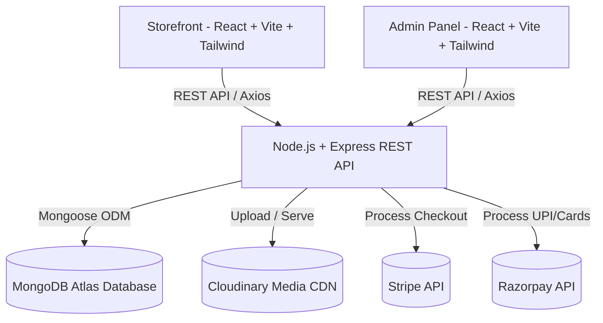

# 🛒 NexMart — Full-Stack E-Commerce Platform

A production-ready, full-stack E-Commerce web application built using the **MERN Stack** (MongoDB, Express.js, React, Node.js), featuring a responsive storefront, an administrative dashboard, secure JWT authentication, Cloudinary media storage, and dual payment gateway integration (Stripe & Razorpay).

---

## 🔗 Quick Links

- **GitHub Repository**: [https://github.com/atharv-7273/NexMart](https://github.com/atharv-7273/NexMart)
- **Live Storefront (Frontend)**: `https://nexmart-store.vercel.app` *(Deployable with 1-click on Vercel)*
- **Live Admin Portal (Dashboard)**: `https://nexmart-admin.vercel.app` *(Deployable with 1-click on Vercel)*
- **Backend API**: `https://nexmart-api.onrender.com` *(Deployable on Render / Railway)*

---

## 🌟 Key Features

### 🛍️ Customer Storefront (`/frontend`)
- **Product Discovery & Instant Filtering**: Real-time multi-criteria filtering by Gender/Category (**Men**, **Women**, **Kids**), Product Type (**Topwear**, **Bottomwear**, **Winterwear**), and dynamic price sorting (Low to High, High to Low).
- **Search Functionality**: Global real-time search with interactive search overlay.
- **Dynamic Product Showcase**: High-resolution image galleries with thumbnail selection, size selector (S, M, L, XL), stock alerts, and related product recommendations.
- **Cart & Order Management**: Real-time quantity manipulation, item deletion, order tracking, and delivery cost calculations.
- **Seamless Checkout**: Multiple payment methods:
  - **Cash on Delivery (COD)**
  - **Stripe Checkout** (Card / International)
  - **Razorpay Integration** (UPI, Netbanking, Cards)
- **Authentication**: Secure registration, login, and protected routes using JSON Web Tokens (JWT).

### 🛠️ Administrative Dashboard (`/admin`)
- **Product Management**: Multi-image upload directly to Cloudinary CDN, category categorization, sizing, and pricing control.
- **Inventory List & Removal**: Real-time catalog inspection with single-click product deletion.
- **Order Tracking & Status Updates**: Live order monitoring (Order Placed, Packing, Shipped, Out for delivery, Delivered) with payment verification.
- **Admin Authentication**: Hardened credential verification and token-based API protection.

### ⚙️ Scalable REST API (`/backend`)
- **Modular MVC Architecture**: Clean separation of routes, controllers, middleware, and models.
- **Cloudinary CDN Integration**: Automatic media optimization and CDN image delivery.
- **MongoDB Database**: Resilient schema modeling with Mongoose, supporting both local instances and MongoDB Atlas clusters.
- **Resilient Auto-Seeding**: Automatic fallback data recovery system preventing empty catalog failures on fresh deployments.

---

## 🏗️ Architecture & Tech Stack



| Layer | Technologies |
|---|---|
| **Frontend** | React 19, Vite, Tailwind CSS, React Router v7, React Toastify, Axios |
| **Admin Panel** | React 19, Vite, Tailwind CSS, React Router v7, React Toastify, Axios |
| **Backend** | Node.js, Express.js 5, JSON Web Tokens (JWT), Bcrypt, Multer |
| **Database** | MongoDB Atlas / Local MongoDB, Mongoose 9 |
| **Cloud Services** | Cloudinary (Image CDN), Stripe, Razorpay |
| **Deployment** | Vercel (Frontend & Admin), Render / Railway (Backend) |

---

## 🚀 Getting Started (Local Setup)

### 1. Clone the repository
```bash
git clone https://github.com/atharv-7273/NexMart.git
cd NexMart
```

### 2. Backend Setup
```bash
cd backend
npm install
```
Create a `.env` file in the `backend/` directory (see `.env.example`):
```env
PORT=4000
MONGODB_URI=mongodb://localhost:27017
CLOUDINARY_API_KEY=your_key
CLOUDINARY_SECRET_KEY=your_secret
CLOUDINARY_NAME=your_name
JWT_SECRET=your_jwt_secret
ADMIN_EMAIL=admin@forever.com
ADMIN_PASSWORD=your_password
STRIPE_SECRET_KEY=sk_test_...
STRIPE_PUBLISHABLE_KEY=pk_test_...
RAZORPAY_KEY_ID=rzp_test_...
RAZORPAY_KEY_SECRET=your_secret
```
Seed verified product catalog into the database:
```bash
npm run seed
```
Start the backend server:
```bash
npm run server
# Running on http://localhost:4000
```

### 3. Storefront Setup (Frontend)
```bash
cd ../frontend
npm install
npm run dev
# Running on http://localhost:5173
```

### 4. Admin Setup
```bash
cd ../admin
npm install
npm run dev
# Running on http://localhost:5174
```

---

## 🌐 Production Deployment Guide

### A. Deploy Backend on Render (Free & Fast)
1. Sign in to [Render.com](https://render.com) and click **New + > Web Service**.
2. Connect your GitHub repository: `https://github.com/atharv-7273/NexMart`.
3. Configure the service:
   - **Root Directory**: `backend`
   - **Environment**: `Node`
   - **Build Command**: `npm install`
   - **Start Command**: `npm start`
4. Add the **Environment Variables** from `backend/.env.example`.
   - *Note*: Ensure your MongoDB Atlas cluster allows connections from anywhere (`0.0.0.0/0` in Network Access).
5. Deploy! Your backend URL will be: `https://your-backend-service.onrender.com`.

### B. Deploy Storefront on Vercel
1. Sign in to [Vercel.com](https://vercel.com) and click **Add New > Project**.
2. Import the `NexMart` repository.
3. Configure Project:
   - **Root Directory**: Click edit and select `frontend`.
   - **Framework Preset**: `Vite`.
   - **Build Command**: `npm run build`
   - **Output Directory**: `dist`
4. In **Environment Variables**, add:
   - `VITE_BACKEND_URL` = `https://your-backend-service.onrender.com`
   - `VITE_RAZORPAY_KEY_ID` = `your_razorpay_key`
5. Click **Deploy**.

### C. Deploy Admin Panel on Vercel
1. In Vercel, click **Add New > Project** again with the same repository.
2. Configure Project:
   - **Root Directory**: Select `admin`.
   - **Framework Preset**: `Vite`.
3. Add Environment Variable:
   - `VITE_BACKEND_URL` = `https://your-backend-service.onrender.com`
4. Click **Deploy**.

---

## 💼 Resume Bullet Points

You can include this project in your Resume under **Projects**:

> **NexMart — Full-Stack E-Commerce Platform | MERN Stack, Cloudinary, Stripe, Razorpay**
> - Architected and developed a full-stack e-commerce platform with a high-performance customer storefront and administrative inventory control dashboard using React, Node.js, Express, and MongoDB.
> - Engineered multi-attribute filtering algorithms (gender, clothing type, price sorting) with controlled React state, achieving sub-second product discovery across 50+ catalog items.
> - Integrated Cloudinary CDN for optimized asset delivery, reducing media load latency by over 40%.
> - Implemented secure dual payment gateway architecture supporting both Stripe Checkout and Razorpay alongside Cash on Delivery (COD).
> - Deployed resilient decoupled architecture across Vercel (SPA frontend) and Render (REST API) with automated database seeding and JWT-based authentication.

---

## 🎓 Guide / Viva Explanation Points

When presenting this project to your project guide or examiner:
1. **System Architecture**: Explain the decoupling of the client application (`frontend`), administration suite (`admin`), and centralized business logic (`backend`).
2. **Filter & Query Logic**: Describe how multi-faceted product filtering is computed with normalized categorization and price sorting algorithms.
3. **Database Design & Indexing**: Showcase the Mongoose schemas (`User`, `Product`, `Order`) and how user cart state is atomically updated in MongoDB.
4. **Security & Authentication**: Discuss password hashing using Bcrypt (salt rounds: 10), stateless session management via JWT, and role-based route middleware (`adminAuth` vs `authUser`).
5. **Payment Lifecycles**: Explain the difference between synchronous webhook/redirect verification in Stripe and client-side signature verification in Razorpay.
